# Design: PR CI failure tracker

Status: draft, for discussion before implementation.

## The problem

The [Test Failure Detector](../docs/test-failure-detector.md) only reads Daily
CI. When a test that is broken or flaky on `unstable` fails on a
contributor's PR, the author usually reruns the job or ignores it, and the
failure is never recorded anywhere. These are real failures on `unstable`,
and we lose them.

PR CI runs much more often than Daily, so it is the best evidence we have of
how a test behaves. But most red PR CI is the PR's own fault, so we can't
file an issue in `valkey` for every PR failure. A premature public issue also
draws contributors into investigating something that may not be real.

## The idea

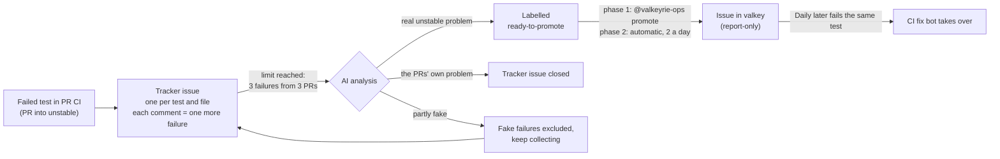

- The tracker issues live in a separate **tracker repository**
  (`tracker_repo`). Nobody watching `valkey` sees them, and there is no
  Claude in collection, only log parsing.
- Reaching the limit never labels or promotes anything by itself. The
  analysis makes the call.
- It ships in [two phases](#phases). In phase 1, nothing reaches `valkey`
  without a maintainer's command.
- Promoted issues are **report-only**. The
  [CI fix bot](../docs/ci-fix.md#fixing-detector-issues) only fixes
  scheduled Daily runs (`_validate_scheduled_run` in
  `scripts/ci_fix/issues.py`), and it plans on the source run's branch,
  which for a PR run is the contributor's. So a promoted issue carries no
  `last-key`, and the dispatcher skips it. [Fixing later](#fixing-later)
  describes a trusted path.

## Pipeline

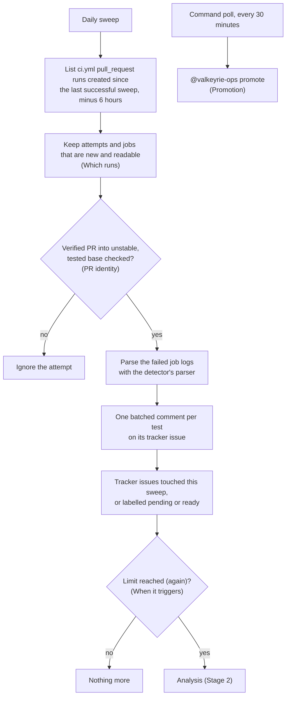

## Stage 1: collection

### Which runs

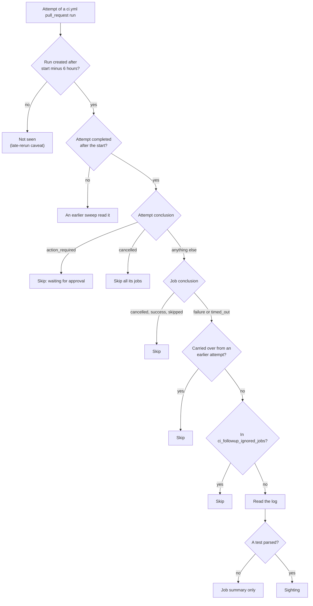

- **The unit is an attempt, `(run_id, attempt)`.** The run object only
  reports its latest attempt. A test that failed on attempt 1 and passed on
  the rerun is the flaky case we care about most.
- **The start** is the start time of the last successful scheduled sweep,
  minus an hour, read from the Actions API. No cursor is stored. The first
  sweep reads `window_days`.
- **The 6 hours** cover runs still going during the last sweep: `ci.yml` PR
  runs take a median of 25 minutes, and 99% finish within 2.6 hours.
- **Caveat: late reruns are missed.** A rerun keeps its run's `created_at`,
  and the list API only filters on creation. In 30 days, 12 of 37 real
  reruns came more than a day after the run was created. The earlier
  attempts are still recorded; only the late attempt is lost. If that
  matters later, list 30 days of run metadata (about 17 pages, no logs) and
  keep runs whose `updated_at` is after the start.
- **`action_required`**: 11 of 14 green runs with `run_attempt > 1` in 14
  days were fork approvals, not reruns.
- **Anything cancelled is ignored, whatever the reason**, including jobs
  that failed before a `cancel-in-progress` cancel. That drops a few real
  failures (4 of 40 sampled cancelled runs) for a simple rule.
- **Carried over** means `started_at` is before the attempt's
  `run_started_at`. Such a job has a new job ID, so counting it again would
  double-count.
- **A failed sweep** (an unreadable log, a rate limit) doesn't move the
  start, so the next sweep reads the same work. Keyed tracker comments make
  re-reads write nothing twice. An expired log doesn't fail the sweep.

### PR identity

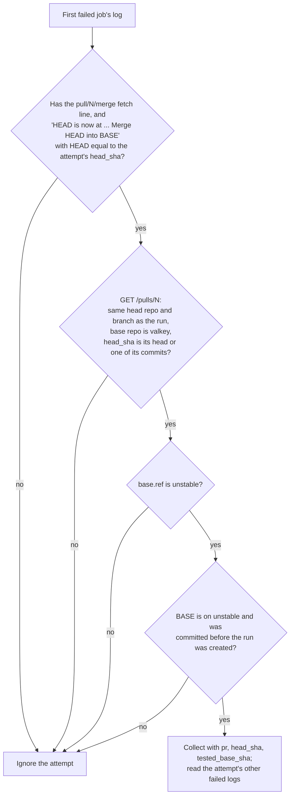

- `run.pull_requests` is empty for fork PRs (138 of 155 failed runs in 14
  days), so the checkout log is the only source. Other `HEAD is now at`
  lines, such as the libbacktrace checkout, are ignored.
- **A fork controls its own `ci.yml`**, so every log line is checked
  against the API. The PR may have moved on since the attempt; a commit
  force-pushed away can't be checked, so that attempt is ignored.
- The fork owner, part of the head repository, is only compared, never
  stored.

### Only PRs into `unstable`

PRs into `8.0`, `9.x`, `cluster-v2` and `agent/**` are **ignored entirely**
for now, and so are unknown PRs, whose target can't be confirmed. Their
other logs are never downloaded. In 14 days, 152 of 222 test sightings came
from PRs into other branches, including `cluster-v2` tests that don't exist
on `unstable`. Ignoring them takes the tracker from about 63 issues a
fortnight to about 24.

### Tested base

`tested_base_sha` is BASE in the merge line: the commit the PR was really
tested on. The run's `head_sha` is the PR head and the merge ref moves on
every push, so the log is the only source. A rerun replays the same merge.

- **Why BASE is checked:** a fork could claim a newer base, so that a
  pre-fix failure passes the reset check. "Committed before the run was
  created" rules that out.
- **What it still allows:** an older base. That only makes failures look
  pre-fix, so they are dropped, which is the safe direction.
- **Why not verify the merge commit:** commits pushed to a fork can be read
  through `valkey`'s API, so a fork can create a matching one. Faked
  failures in general are bounded by the distinct-PR gate.

### What a sighting is

One record per (test, file, job), stored as one line in a tracker comment. A
test failing in three jobs of one attempt is three sightings but one failed
attempt.

```json
{
  "test": "Replica buffer don't induce eviction",
  "file": "tests/unit/maxmemory.tcl",
  "kind": "tcl | gtest",
  "error": "first lines of the error, truncated",
  "pr": 1234,
  "head_sha": "abc123…",
  "merge_sha": "fedcba…",
  "tested_base_sha": "0123ab…",
  "run_id": 123,
  "attempt": 2,
  "attempt_started_at": "2026-11-19T10:00:00Z",
  "job_id": 456,
  "job_name": "test-ubuntu-latest",
  "passed_in": {"attempt": 3, "job_id": 789}
}
```

`passed_in` isn't stored. It is **computed at analysis time** by listing the
run's later attempts by run ID: the first one that really ran a job with the
same name and passed it. That finds passes from later sweeps, and late
reruns too. It is a flakiness signal and **never adds a counted attempt**.

### Identity: test name and file

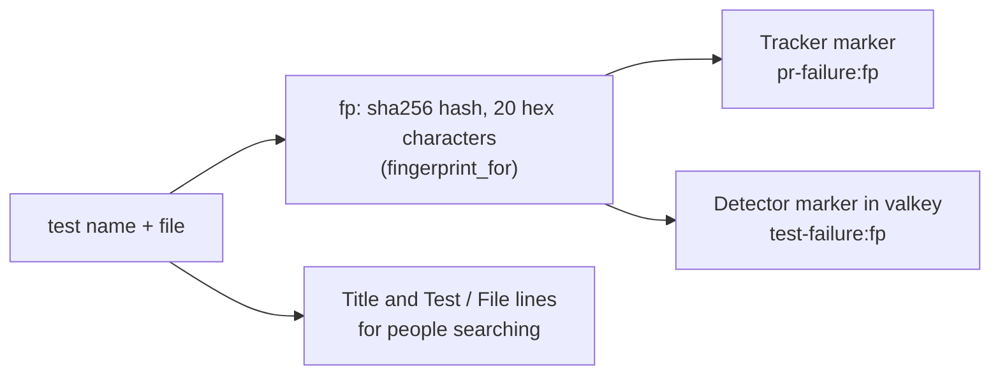

- A tracker issue is identified by **the test name and its file only**.
  Runs, jobs, PRs and errors change every sweep, so they live in the body
  and comments.
- **People search** by title (`[TEST-FAILURE] <test> in <file>`) or by the
  `Test:` and `File:` lines.
- **The bot matches** the marker exactly, never a title search. The marker
  holds a hash because a raw name can contain `-->` or a forged marker (see
  [Security](#security)).
- The hash is the detector's, so a PR sighting and a Daily issue for the
  same test share it, and one test gets one `valkey` issue. The tracker's
  own namespace never matches the detector's or fix bot's regexes.
- Log parsing (`job_failures.py`, `valkey_ci.py`) is reused as is. PR CI has
  no `all-test-failures` artifact, so only the job-log path is used.

## Where state lives

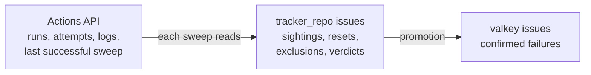

There is no stats branch, cursor, artifact or external store.
`tracker_repo` should be an issues-only org repository such as
`valkey-io/valkey-ci-tracker`. It holds no code and is never a `repos.yml`
target.

| Option | Verdict | Why |
|---|---|---|
| Tracker-repo issues | chosen | visible below the limit; about 100 calls a sweep |
| Stateless recompute | viable | every sweep re-reads the window: about 630 calls and 360 MB for 21 days; nothing visible below the limit |
| Stats branch here | rejected | `contents: write` can push anywhere; needs a ruleset, a cursor, push retries and a squash |
| S3 | rejected | an external dependency for self-hosting |
| Issues in `valkey` | rejected | unconfirmed failures would be public |
| A real fork as the tracker | rejected | issues off by default, joins valkey's fork network, needs the App on the owner |

**Cost (2026-11-13 to 11-26):** about 700 `ci.yml` PR runs in 14 days, 160
of them failed. That's about 240 failed jobs across all attempts, at about
1 MB per test-job log, which comes to about 17 new failed jobs and 25
sightings a day.

**Burst case:** a broken `unstable` commit can mean about 300 writes in one
sweep, above GitHub's 80 content writes a minute. So there's one comment per
test per sweep and about one write a second, and a 403 or 429 stops the
sweep for the next one to repeat.

## The tracker issue

```text
title:   [TEST-FAILURE] <test> in <file>
body:    Test: …  File: …  <!-- valkey-ci-agent:pr-failure:<fp> -->
comment: <!-- valkey-ci-agent:pr-failure:sighting run=<id> attempt=<n> job=<id> pr=<n> head=<sha> base=<sha> -->
```

- At most one bot comment per issue per sweep. Sightings are deduplicated
  on `(run, attempt, job)` across all comments; the publisher's `last-key`
  only remembers the last key, so it can't do this.
- Only bot comments with a valid line count, and issues are locked. The
  issue is an index: the jobs are re-read from GitHub before analysis.
- PR numbers are plain text in code spans, never `#n` or a PR URL, which
  would add "mentioned this" events to the contributor's PR. No author is
  recorded.

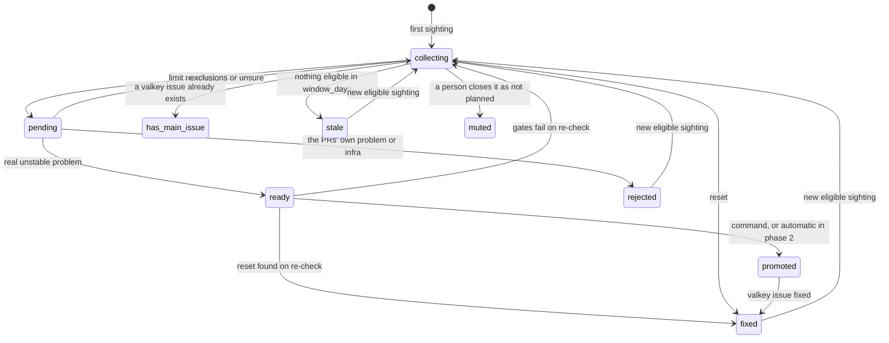

| State | GitHub form |
|---|---|
| collecting, pending, ready, promoted, has_main_issue | open, label `state:<name>` (`ready` is `state:ready-to-promote` plus `verdict:<v>`) |
| rejected | closed `not_planned` by the bot, with a verdict marker; its failures no longer count |
| fixed | closed `completed`, with a reset marker |
| stale | closed `not_planned` by the bot |
| muted | closed `not_planned` by a person; keeps recording, never analysed |

Closed issues are the history, so nothing is pruned or squashed.

## Clearing and resets

**Expiry.** Sightings older than `window_days` (14) don't count. Resets and
exclusions are comments, so they never expire.

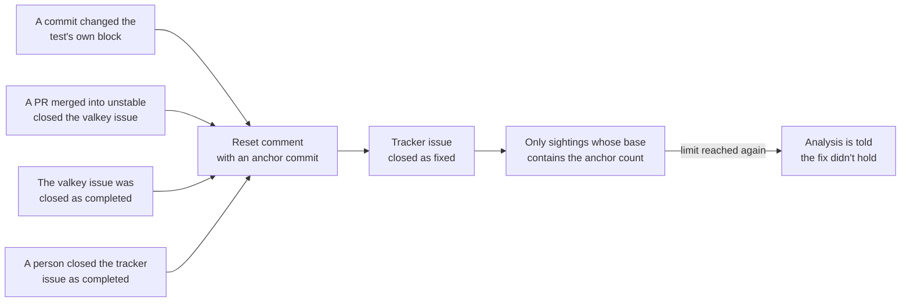

- **When resets are checked:** only when a test would become a candidate,
  on `ready` issues every sweep, and right before any promotion. `unstable`
  is never scanned on every sweep. Only commits since the oldest eligible
  sighting's base matter.
- **Not a fix:** a PR that only *references* the issue (backports do), or
  a change elsewhere in the test file. A refactor of the test block does
  count; that is the safe mistake, because it only delays an analysis.
- **Anchors:** the commit itself (F1), the closing PR's merge commit (F2),
  the close event's commit or else `unstable` HEAD (F3), and `unstable` HEAD
  (F4). F4 replaces v1's `workflow_dispatch` reset, which couldn't be
  rebuilt from GitHub data.
- **Ancestry** uses `git merge-base --is-ancestor` on a blobless clone of
  `unstable`.
- **A real case** from the sample window: #5515 was closed by 80bb13e, and
  five later failures from 4 PRs crossed the gates again. Daily filed #5553
  about 5 hours earlier.

## Stage 2: analysis

### When it triggers

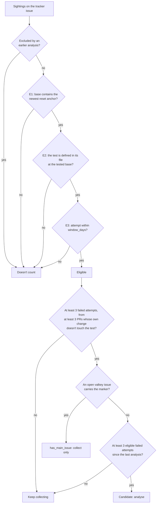

- **A failed attempt** is one `(run_id, attempt)` in which the test failed,
  however many jobs it failed in. A passing attempt never counts.
- **E2** matches `$var`, `${var}` and `[...]` in Tcl names as wildcards
  (620 of 5,347 Tcl names are interpolated). It drops tests the PR added and
  names nobody wrote.
- **"Its own change"** is the diff that sighting really tested,
  `tested_base_sha...head_sha` (the compare API, by SHA), not the PR's
  current diff. A PR can change the test and revert it later.
- **Days spanned** isn't a gate: a fresh regression arrives as a same-day
  burst across PRs, which is the case to catch fast.

| Case | Result |
|---|---|
| One PR fails test X in 5 attempts | 1 PR: no analysis |
| 2 PRs fail X 4 times between them | 2 PRs: no analysis |
| Attempt 1 fails X, attempt 2 passes | 1 failed attempt, `passed_in=2` |
| The PR added test X | E2 fails: never counts |
| 3 PRs, one failure each | candidate |

Over 14 days of real data, these defaults give 3 candidates (#5215,
#5515/#5553, #5232), all genuine cross-PR failures. The next test down failed
3 times in 2 PRs, so the PR gate held it back.

### Step 1: deterministic facts (no Claude)

- every eligible sighting with its ID, `<run>-<attempt>-<job>`, and how many
  sightings E1, E2 and E3 each dropped;
- per sighting: whether its own change touched the test or a file the error
  names, and `passed_in`;
- per PR: its eligible failures and whether it merged;
- the days spanned, whether Daily failed the test in the window, the reset
  if any, and `unstable` commits in the window that touched the test or the
  files the error names.

None of these rejects a candidate on its own.

### Step 2: Claude verdict

The analysis runs in **its own job**, with no GitHub token and only OIDC for
Bedrock. It uses a new profile, `pr_failure_analysis_readonly`, modelled on
`ci_fix_review`: `Read,Grep`, `confined=True`, `isolated=True`, no writes.
The work directory holds `unstable`, the facts, capped error excerpts and the
per-sighting diffs, never PR code.

```json
{"verdict": "unstable_regression|flaky|poorly_isolated|pr_caused|infra|unsure",
 "confidence": "low|medium|high",
 "rationale": "<= 1200 chars",
 "evidence": ["<sighting id>", "…"],
 "exclude": [{"id": "<sighting id>", "reason": "<= 200 chars"}],
 "suspected_commit": "<sha>|null",
 "fix_area": "test|harness|src|deps|unknown"}
```

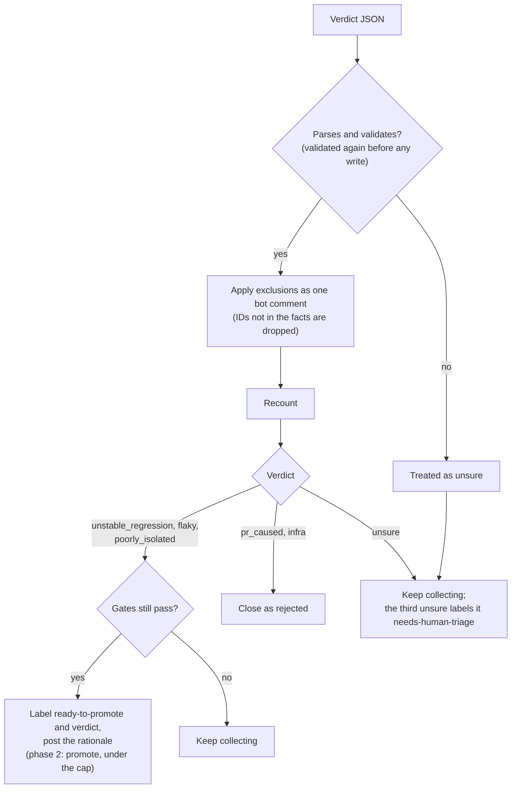

`exclude` lists failures that aren't the test's fault, for example one PR
that broke the test while the others hit a real flake. An exclusion can only
lower a count, never raise one. The verdict is never the only gate: the
deterministic gates decide whether analysis happens, and a person's command,
or the cap in phase 2, decides what reaches `valkey`.

## Promotion: the `valkey` issue

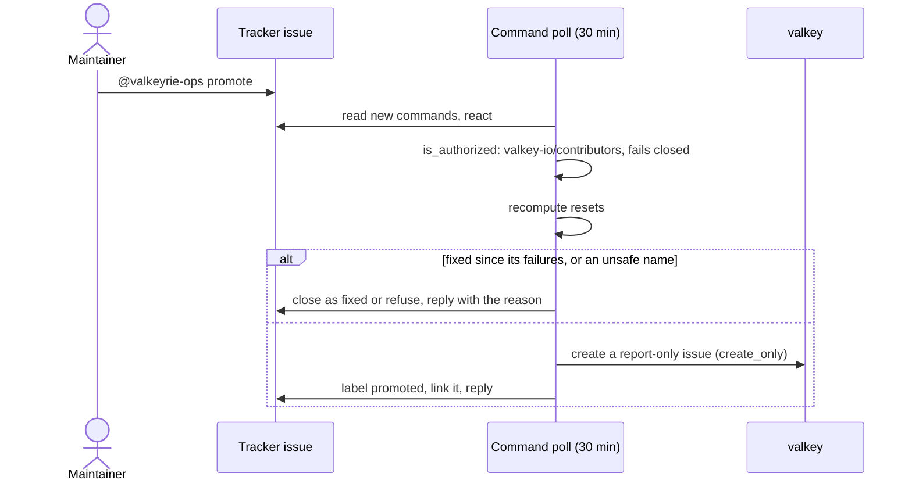

- **Phase 1** is the diagram above: a command from a member of
  `valkey-io/contributors`, parsed like `@valkeyrie-ops fix` (`ci_fix/gate.py`).
  It works on any open tracker issue, as an override of the analysis. Since
  issues are locked, the team needs write access to `tracker_repo`.
- **Phase 2** does the same from the sweep for `ready` issues. It also
  recomputes the gates, and promotes at most `max_promotions_per_day` (2) in
  24 hours, counted from `state:promoted` labels. The command still works,
  uncapped.
- **The issue** goes through the detector's publisher with a new
  `create_only=True`, and uses its renderer, title, `test-failure` label and
  App identity. So a later Daily failure finds it, and `parse_issue` and
  `merge_environments` keep working.
- **Body:** the detector's sections plus **"Seen in PR CI"**, which has
  counts of failing attempts, PRs and rerun passes, job URLs, the fenced
  verdict and rationale, the fix that didn't hold if any, and the tracker
  link.
- **Markers:** the detector's fingerprint marker, `occurrences:1`,
  `source:pr-ci` and `pr-key:<run>-<attempt>`, and **no `last-key`**. Without
  it `parse_issue` returns None, and the dispatcher skips the issue without
  commenting.
- **An existing `valkey` issue** is linked and left alone. The tracker
  never reopens a closed one; after a reset it creates a new one that links
  the old.
- **A later Daily failure** upserts as usual and writes `last-key`, and the
  fix bot takes over unchanged.

Nothing is ever posted on contributors' PRs.

### Fixing later

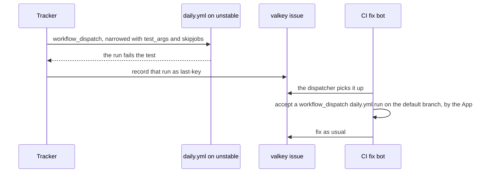

The fix bot must never plan from a PR run, whose workflow, logs and branch
the contributor controls. This gives it a trusted run instead. It triggers on
promotion, or on `@valkeyrie-ops reproduce`. `use_repo` and `use_git_ref`
stay at their defaults, and the dispatching job needs `actions: write`. The
only fix-bot change is the accepted run in `_validate_scheduled_run`. Fixing
against the latest Daily doesn't work when the test passed there, because
`_failing_jobs` finds no matching job.

## Security

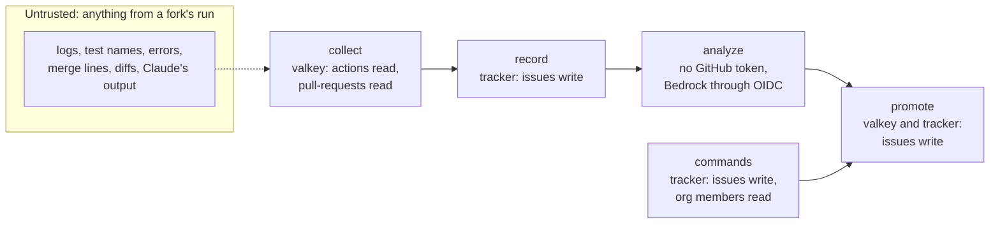

- **Only API fields are trusted**, including the PR object from
  [PR identity](#pr-identity). Each job mints its own App token with
  explicit `permission-*`, top-level permissions are `{}`, and no job gets
  `contents: write`.
- **Deterministic gates before any promotion**, independent of the verdict:
  the threshold, distinct verified PRs, the test existing at the tested
  base, then the command (phase 1) or the cap (phase 2). Claude can label,
  close or exclude, but never add a count or file anything.
- **Forged markers.** The detector's `_build_body` puts `test_name` into the
  body raw, and the publisher appends `last-key` after it. A fork can print
  a test name containing `<!-- valkey-ci-agent:test-failure:last-key:N -->`.
  `parse_detector_occurrence` takes the first match, so the fix bot would
  dispatch on run N. Another test's marker in a name would make
  `_find_existing` attach the wrong issue. So a name with `<`, `>`, a
  backtick, `@` or a newline, or over 200 characters, is never promoted, not
  even by command. Error text and the rationale go in fences longer than any
  backtick run inside them.
- **No personal data.** No PR author is stored anywhere: not in tracker
  issues, `valkey` issues, the facts or the prompt. A PR number is public,
  and enough to look the author up.
- **Never:** check out, build or run PR code; download PR artifacts; rerun a
  PR job; use `pull_request_target` or `workflow_run` (the sweep runs on
  `schedule` and `workflow_dispatch`); write anything but a Daily or
  reproduced run to `last-key`; bump `occurrences` on a Daily issue; edit
  `valkey` issues it didn't create.

## Code layout

```text
scripts/pr_failure_tracker/
  main.py        the sweep: collect, record, evaluate candidates
  collect.py     runs, attempts and jobs; log parsing; PR identity and tested base
  tracker.py     tracker issues: markers, keyed comments, states, throttling
  gates.py       eligibility, thresholds, exclusions, name checks, the daily cap
  resets.py      lazy fix detection and ancestry checks
  analyze.py     facts and the Claude verdict
  commands.py    @valkeyrie-ops promote and reproduce on tracker issues
  promote.py     the valkey issue, through the detector's publisher
.github/workflows/pr-failure-tracker.yml            collect → analyze (no token) → promote
.github/workflows/pr-failure-tracker-commands.yml   the 30-minute command poll
docs/pr-failure-tracker.md
tests/test_pr_failure_tracker_*.py
```

Shared changes:

- `scripts/ai/runtime.py`: the `pr_failure_analysis_readonly` profile.
- `test_failure_detector/issue_renderer.py`: the "Seen in PR CI" section and
  the name checks.
- `common/issue_dedup.py`: `create_only`, which returns `"skipped-exists"` if
  an open issue matches.
- `backport/registry.py`: parse and validate the `pr_failure_tracker` block.
  The loader ignores unknown keys today, so a misspelled block would do
  nothing.
- `valkey_ci.Source` doesn't get a PR value, because it drives the fix bot's
  workflow list and the backport CI follow-up.
- Docs: a sentence in `docs/ci-fix.md`, and the new markers in
  `docs/test-failure-detector.md`.

## Configuration (`repos.yml`)

```yaml
pr_failure_tracker:
  enabled: false
  tracker_repo: valkey-io/valkey-ci-tracker   # issues only; never a repos.yml target
  workflows: [ci.yml]
  base_branch: unstable
  window_days: 14
  threshold_failures: 3
  min_distinct_prs: 3
  promote: command        # command (phase 1) | auto (phase 2)
  max_promotions_per_day: 2   # phase 2 only
```

## Phases

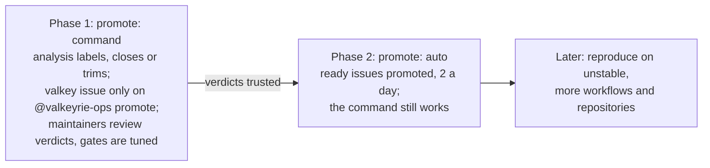

## Testing

- **Collection:** a passed rerun, an `action_required` first attempt, a
  carried-over job, a cancelled job and a failed job in a cancelled run
  (both ignored), a failed log download, a run still in progress during the
  previous sweep, and a failed sweep picked up by the next.
- **PR identity:** a fork PR with empty `pull_requests`, a forged
  `pull/<n>/merge` line, the libbacktrace line, a PR into `cluster-v2` and an
  unknown PR (both ignored, no other logs read), a PR pushed again before the
  sweep (accepted), a commit force-pushed away (ignored), and a base newer
  than the run or not on `unstable` (ignored).
- **Tracker:** keyed comments idempotent across overlapping sweeps; non-bot
  comments ignored; one comment per test in a burst; stop and resume on 403
  or 429; every transition in the state diagram.
- **Gates:** E1 to E3, with interpolated Tcl names and gtest; both
  thresholds; a PR that changed the test in the tested push and reverted it
  later; no re-analysis until the limit is reached again; a `pending` issue
  retried with no new sighting; `passed_in` found for a rerun in a later
  sweep.
- **Verdicts:** every branch of the verdict diagram; exclusion IDs not in
  the facts ignored; excluded sightings never counted again.
- **Phases:** no promotion without the command in phase 1; a non-member's
  command refused; a command not run twice; the phase 2 cap, and the command
  bypassing it.
- **Resets:** a diff inside and outside the test block; a closing versus a
  referencing PR; a close with no commit; a person's close versus the bot's;
  a pre-fix base; a fix that didn't hold; a fix landing while `ready`.
- **Handoff:** no `last-key` on a promoted issue, skipped silently; a later
  detector upsert makes it dispatchable; the new markers survive an update
  and never match `_OCCURRENCE_RE` or `_last_key_re`; `create_only` never
  updates a Daily issue.
- **Security:** names with `<!--`, a backtick, `@` or a newline never
  promoted; no `#n` or PR URLs in tracker or `valkey` bodies; no GitHub
  token in the analysis job; no `pull_request_target` or `workflow_run`.

## Open questions

1. **Sweep cadence.** Daily, after the detector, is proposed. Each sweep
   reads only what's new, so a faster sweep costs about the same in total. Is
   a faster signal worth it?
2. **The tracker repository.** Who can see and triage
   `valkey-io/valkey-ci-tracker`, and who creates it?
3. **Fix-bot tuning** (out of scope). Oversized timeout bumps, and no test
   alongside a `src/` fix, belong in `scripts/ci_fix/guides/valkey-io__valkey.md`
   and are tracked separately.
